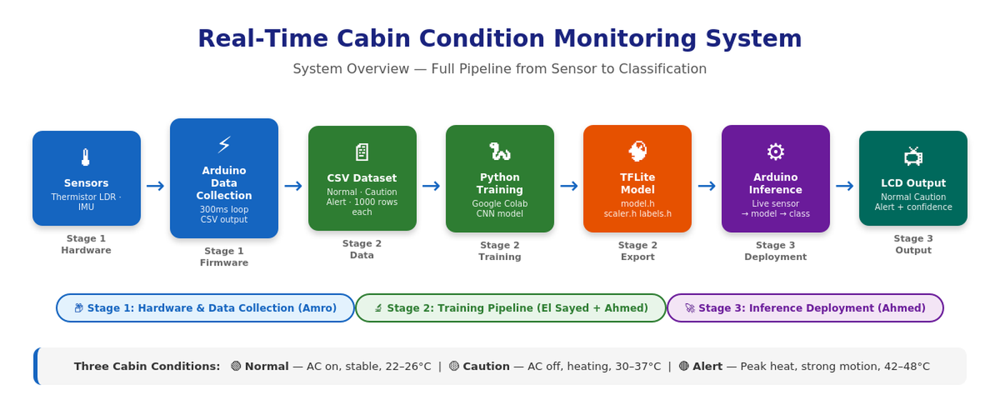
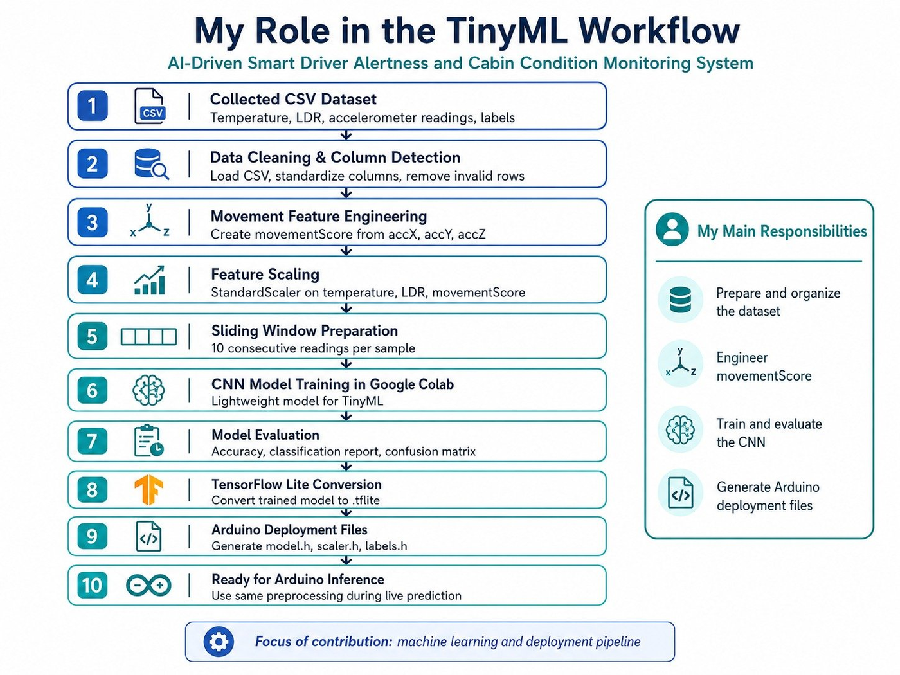
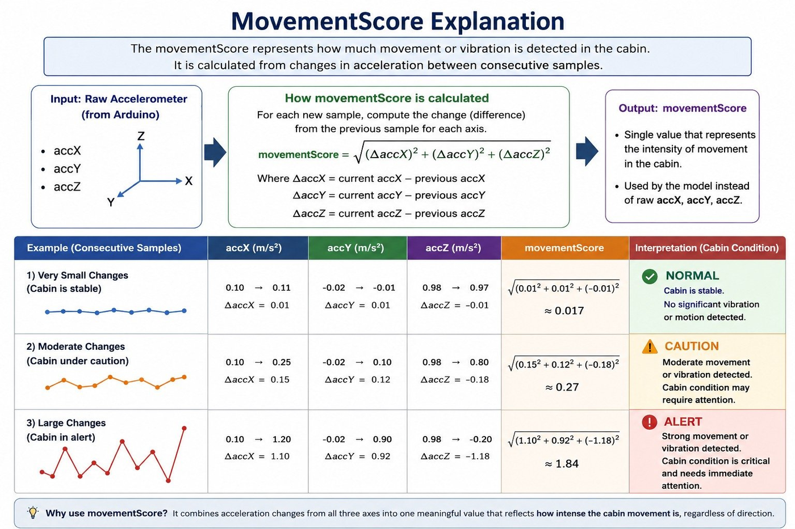
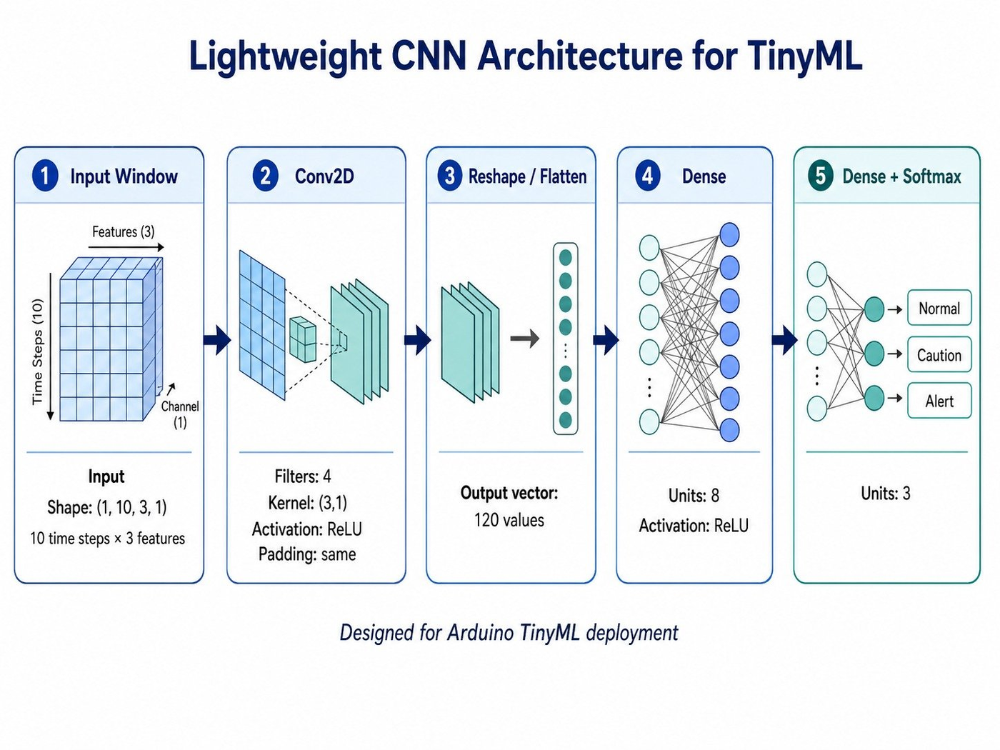
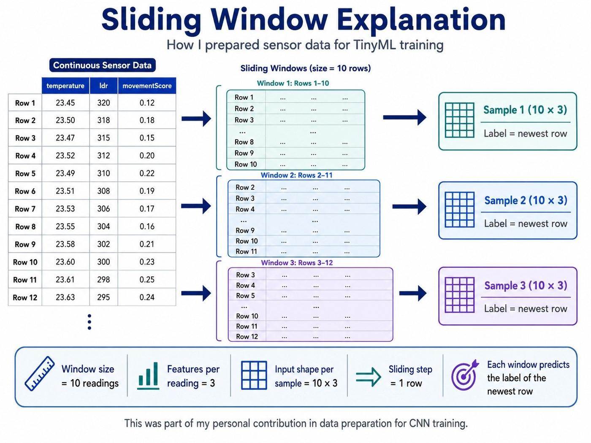
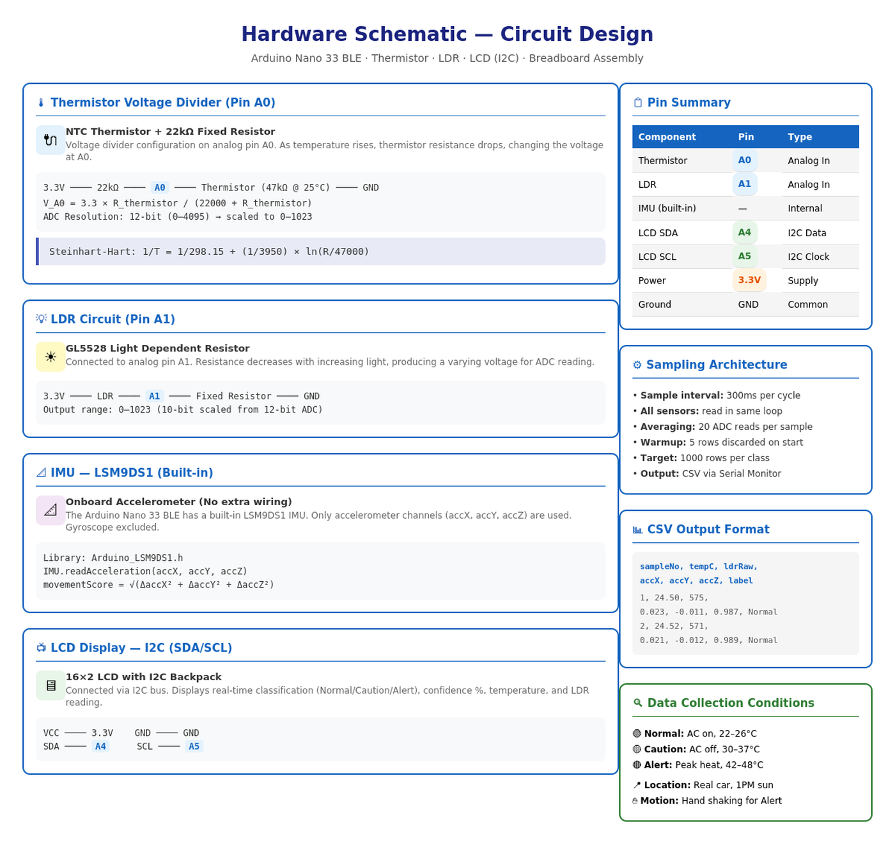

<h1 align="center">AI Cabin Condition Monitor</h1>

<p align="center">
  Real-time TinyML system that classifies a vehicle cabin as <b>Normal</b>, <b>Caution</b> or <b>Alert</b>, running entirely on an Arduino.
  <br/>AIRE325 · Abu Dhabi University
</p>

<p align="center">
  
  
  
  
</p>

<p align="center">
  <a href="https://www.youtube.com/shorts/H5C3fHJLsO8"><b>Watch the demo</b></a>
</p>

<p align="center">
  
</p>

## What it does

The device reads **temperature**, **light** and **motion** every 300 ms, feeds the last 3 seconds of readings into a tiny CNN, and shows the predicted cabin state with a confidence score on an LCD. A buzzer gives one beep for Caution and three for Alert. Everything runs on the microcontroller, with no laptop or internet needed.

| Condition | Scenario | Typical temperature |
|---|---|---|
| **Normal** | AC on, stable cabin | 22–26 °C |
| **Caution** | AC off, cabin heating up | 30–37 °C |
| **Alert** | Peak heat and strong motion | 42–48 °C |

## Results

| Metric | Value |
|---|---|
| Test accuracy | **99.8%** (598 of 599 windows) |
| Precision / recall / F1 | 1.00 for all three classes |
| Model parameters | 1,011 |
| TFLite model size | 6,412 bytes |
| Tensor arena | 48 KB |

```
Confusion matrix      Normal  Caution  Alert
Normal                  199       0      0
Caution                   0     200      0
Alert                     0       1    199
```

## How it works

<p align="center"></p>

1. **Data collection:** the Arduino logs 1,000 labelled samples per class (temperature, LDR, accelerometer) to CSV.
2. **Feature engineering:** raw accX/Y/Z become a single orientation-independent **movementScore**, the magnitude of the change between consecutive readings.
3. **Preprocessing:** a StandardScaler normalizes the features, then sliding windows of 10 readings × 3 features are built.
4. **Training:** a tiny Conv2D → Dense → Softmax CNN is trained in Google Colab. It avoids ops that older TFLite Micro builds lack.
5. **Export:** the model is converted to TFLite and exported as `model.h`, `scaler.h` and `labels.h`.
6. **On-device inference:** the Arduino scales live readings with the same means and scales, runs `Invoke()`, and displays the top class.

| Movement score | CNN architecture |
|:--:|:--:|
|  |  |
| **Sliding windows** | **Hardware schematic** |
|  |  |

## Hardware

| Component | Purpose |
|---|---|
| Arduino Nano 33 BLE Sense | Microcontroller with an onboard LSM9DS1 IMU |
| 47 kΩ NTC thermistor + 22 kΩ resistor (A0) | Cabin temperature |
| LDR (A1) | Light level |
| 16×2 I²C LCD | Prediction, confidence, temperature and light |
| Buzzer (D9) | Audible Caution and Alert |

## Repository layout

```
arduino/cabin_monitor_inference/   Arduino sketch + model.h, scaler.h, labels.h
training/                          Google Colab notebook (data prep, CNN training, TFLite export)
docs/                              Design tools catalogue, requirements and constraints, learning notes
images/                            Diagrams
```

## Running it

1. **Train (optional):** open `training/AIRE325_TinyML_Training.ipynb` in Google Colab, upload the CSV data, and run all cells to regenerate the header files.
2. **Deploy:** open `arduino/cabin_monitor_inference/cabin_monitor_inference.ino` in the Arduino IDE, install `Arduino_LSM9DS1`, `LiquidCrystal_I2C` and `Arduino_TensorFlowLite`, and upload to the Nano 33 BLE Sense.

## Team

| Member | Role |
|---|---|
| **Amr Jalad** | Hardware and data collection |
| **Elsayed Hesham** (team lead) | Dataset preparation and feature engineering |
| **Ahmad Atef** | Model training and inference deployment |

---

<p align="center"><a href="https://github.com/loliamro">github.com/loliamro</a> · <a href="https://www.linkedin.com/in/amrjallad/">LinkedIn</a></p>
